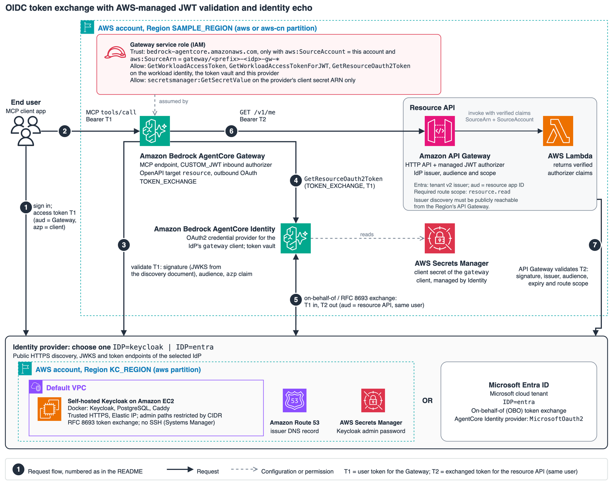

# sample-agentcore-oidc-token-exchange

[中文说明](README_CN.md)

Demonstrate an end user's OIDC identity through Amazon Bedrock AgentCore Gateway and
AgentCore Identity token exchange, using **Keycloak self-hosted on Amazon EC2** (default)
or **Microsoft Entra ID** (`IDP=entra`).
The downstream API echoes claims supplied by an **Amazon API Gateway HTTP API JWT authorizer**.
The Lambda function presents the identity claims already verified by the managed authorizer.

> **Disclaimer:** This repository is an example only and is NOT intended for production use.
> You are responsible for testing, securing and optimizing it for your requirements.
> It creates chargeable AWS resources; use a disposable sandbox with synthetic identities.

## Architecture



The diagram shows Keycloak or Microsoft Entra ID, selected by `IDP`, with the same managed
boundaries. The numbered example uses Keycloak; Entra's identifiers and exchange protocol are described below.

1. A test user signs in to Keycloak and obtains T1 with audience `gateway`.
2. The client invokes the Gateway MCP tool `resource___whoami` with T1.
3. The Gateway's managed `CUSTOM_JWT` authorizer checks the issuer's keys, audience
   and configured `azp=app` claim through AWS service configuration.
4. The Gateway requests a downstream token through AgentCore Identity.
5. Identity authenticates as Keycloak's confidential `gateway` client and performs
   RFC 8693 token exchange. T2 has audience `resource-api` and scope `resource.read`.
6. The Gateway invokes `GET /v1/me` with T2.
7. API Gateway validates T2 with its native JWT authorizer and route scope.
   Lambda returns `requestContext.authorizer.jwt.claims` unchanged as JSON.

The response demonstrates the caller's subject and authorized party after exchange.
An identity satisfying the managed gate receives its own claims. The selected IdP's token
issuance policy governs which identities can obtain qualifying tokens.
Do not add sensitive business data to the echo function without a separate access-control design.

| Path | Purpose |
|---|---|
| `resource-api/` | Standard-library-only identity echo, ZIP builder and managed JWT API deployment |
| `gateway/provision.py` | Identity credential provider, scoped Gateway role and one OpenAPI `whoami` tool |
| `idp/keycloak/` | AWS infrastructure, realm/client/scope/test-user setup and token-exchange adapter |
| `idp/entra/` | Entra app registrations, delegated consent, synthetic users and OBO adapter |
| `lib/` | IdP selection, separate state/evidence paths, secret helpers, HTTPS-only client and bounded waiting |
| `tests/test_*.py` | Offline handler, provisioning, helper and repository-hygiene tests |
| `tests/e2e/` | Explicitly invoked checks of an already deployed sandbox |
| `scripts/cleanup.py` | Dry-run-first deletion of the sample resources |
| `docs/architecture.drawio` | Editable source for the SVG and PNG diagram |

## Prerequisites

- Python 3.10+, AWS CLI v2 and AWS credentials allowed to provision the listed resources.
- AgentCore Gateway and Identity, API Gateway HTTP APIs with JWT authorization, Lambda,
  IAM, Secrets Manager and CloudWatch Logs in the selected application Region.
- Keycloak only: a Route 53 hosted zone and an unused public DNS name.
- Keycloak only: a default VPC in `KC_REGION`; EC2, Elastic IP, encrypted EBS and Systems Manager access.
- Keycloak only: a clean, dedicated realm. Setup adds its clients, scopes and users;
  the administrator is responsible for managing any other realm configuration.
- Entra only: Azure CLI and a **dedicated, disposable test tenant with no real users or data**.
  Sign in interactively as its tenant administrator with `az login`, completing MFA.
  Keep Security defaults, Conditional Access and MFA controls enabled. The synthetic-user
  password grant cannot satisfy MFA. If policy blocks it, **stop the unattended tests**;
  use isolated Keycloak or adapt the client to authorization code + PKCE. Do not disable
  controls or exclude identities to make this sample pass.

Keycloak's discovery, JWKS and login/token endpoints must be reachable over trusted
public HTTPS by the managed services. Its admin paths are limited by `KC_ADMIN_CIDR`.
The test client uses password grants solely for disposable test identities.
Real user applications should use the IdP's supported authorization-code/PKCE flow.

## Deployment

```sh
git clone https://github.com/aws-samples/sample-agentcore-oidc-token-exchange.git
cd sample-agentcore-oidc-token-exchange
pip install -r requirements.txt

export KC_HOSTNAME=keycloak.example.com
export KC_HOSTED_ZONE_ID=<your-hosted-zone-id>
export KC_ADMIN_CIDR=<your-admin-public-ip>/32
export KC_REALM=sample
export SAMPLE_REGION=us-west-2
export IDP=keycloak

resource-api/build.sh .build
python idp/keycloak/infra.py
python idp/keycloak/setup.py
python resource-api/deploy.py .build/resource-api.zip
python gateway/provision.py
```

Wait for the Keycloak certificate before running setup, and run administrative commands
from the allowed CIDR. The Lambda archive contains no third-party packages.
The API deployment disables the default endpoint during changes, configures the JWT gate,
gates existing routes before uploading the echo code, removes routes other than `GET /v1/me`,
and enables the endpoint only after configuration succeeds. A failed deployment may leave
the endpoint disabled; correct the error and rerun. Custom domains and manually added
stages/integrations are outside this deployment script's supported configuration.

The HTTP API is named `<prefix>-<idp>-resource-api-jwt`. Deployment manages a dedicated
endpoint for the function. An API named `<prefix>-<idp>-resource-api`, if present,
is deleted while Lambda invocation permission is suspended. This maintenance can interrupt
service and change the endpoint URL. Rerun `gateway/provision.py` and update direct clients
after deployment.

| Variable | Default | Meaning |
|---|---|---|
| `IDP` | `keycloak` | `keycloak` or `entra` |
| `ENTRA_TENANT_ID` | Required for Entra setup/cleanup | Disposable tenant GUID; must match the Azure CLI login |
| `SAMPLE_PREFIX` | `sample-oidc` | Application and AWS resource name prefix |
| `SAMPLE_REGION` / `SAMPLE_PROFILE` | `us-west-2` / default chain | Region and credentials for API, Gateway and Identity |
| `SECRETS_REGION` | `us-west-2` | IdP secrets, using the global-account default credential chain |
| `SAMPLE_STATE` | `.state` | Non-secret resource identifiers; use `.state-<suffix>` for another deployment |
| `KC_HOSTNAME`, `KC_HOSTED_ZONE_ID` | Required | Public issuer DNS name and Route 53 hosted zone |
| `KC_REGION` | `us-west-2` | Keycloak EC2 Region in the global `aws` partition |
| `KC_REALM` | `sample` | Dedicated realm; choose a different realm for a different prefix on the same server |
| `KC_INSTANCE_TYPE` / `KC_VERSION` | `t3.medium` / `26.8.1` | Applied when creating the instance |
| `KC_ADMIN_CIDR` | Detected public IP `/32` | Source allowed to access admin/master/health/metrics paths; creation-time setting |
| `SAMPLE_GATEWAY_DEBUG` | Unset | `1` exposes detailed Gateway errors; leave unset outside debugging |

Issuer, audience and route scope are returned by the selected adapter's
`resource_api_config()` and supplied to the managed API configuration. No identity
configuration is placed in the Lambda environment. The inbound Gateway accepts only its
own audience, not the resource API's audience.

### Microsoft Entra ID

Use a checkout containing `idp/entra/` (this fork adds that option to the Keycloak sample).
No Keycloak infrastructure, Route 53 name or EC2 instance is needed. Choose an unused
prefix of 3-40 lowercase letters, digits or hyphens, starting with a letter. Never reuse
an existing application/user name or a prefix from a different tenant.

```sh
export IDP=entra
export ENTRA_TENANT_ID='YOUR-DISPOSABLE-TENANT-GUID'
export AWS_PROFILE='YOUR-GLOBAL-AWS-SANDBOX-PROFILE'
export SAMPLE_PROFILE="$AWS_PROFILE"
export SAMPLE_REGION=us-west-2
export SECRETS_REGION=us-west-2
export SAMPLE_PREFIX=oidc-entra-lab
export SAMPLE_STATE="$PWD/.state-entra-lab"

az login --tenant "$ENTRA_TENANT_ID" --allow-no-subscriptions
aws sts get-caller-identity
python idp/entra/setup.py
resource-api/build.sh .build
python resource-api/deploy.py .build/resource-api.zip
python gateway/provision.py
```

Setup checks the signed-in tenant and retained client credentials before mutations. It creates four single-tenant app
registrations (`<prefix>-app`, `<prefix>-gateway`, `<prefix>-resource-api`, `<prefix>-noscope`), their service
principals, delegated admin consent and two cloud-only synthetic users. It does not create
groups, grant directory admin roles to test users or change tenant security policies.
Admin consent is tenant-wide within this disposable tenant; do not run setup in an
organizational tenant. The main client has only `resource.read` consent for the resource API.
The separate confidential `noscope` client has only `resource.other`, giving the negative
test the same resource audience without the route's required `resource.read`. Entra can
include all consented scopes for a client/resource, not just the requested scope, so these
consents must not be combined on one client.

The apps expose GUID-based `api://<appId>` identifiers. Source client secrets and generated
user passwords go to `<prefix>/entra/app-client`, `gateway-client`, `noscope-client` and `users` in Secrets
Manager using the default AWS credential chain. The state file
`<SAMPLE_STATE>/entra-state.json` contains only IDs. Client secrets expire after 90 days,
are reused on setup reruns and are not automatically rotated; an existing Identity
provider also retains its own secret copy. Use a fresh prefix after cleanup for a new
test deployment rather than assuming a source-secret change rotates the provider.

| Boundary / claim | Keycloak | Entra v2 |
|---|---|---|
| Identity provider | `CustomOauth2`, RFC 8693 | `MicrosoftOauth2`, preset on-behalf-of (OBO) |
| Gateway outbound grant | `TOKEN_EXCHANGE` | `TOKEN_EXCHANGE`; Identity performs the Microsoft OBO protocol |
| Gateway T1 `aud` / `azp` | `gateway` / `app` | Gateway app GUID / client app GUID |
| Resource issuer | Realm URL | `https://login.microsoftonline.com/<tenant-id>/v2.0` |
| Resource T2 `aud` | `resource-api` | Resource app GUID, **not** its `api://` URI |
| Resource scope | `resource.read` in `scope` | `resource.read` in `scp`; requested as `api://<resource-appId>/resource.read` |
| Stable user identity for checks | `sub` | `oid` within the configured tenant; `sub` is pairwise per app |
| Exchanged `azp` | `gateway` | Gateway app GUID |

The Gateway keeps its managed `azp EQUALS <client-appId>` check. There is no no-auth mode
and no token passthrough. API Gateway, not Lambda, handles discovery, keys and token
verification. Lambda remains an unchanged claims echo. Entra tests compare the validated
`oid`; this adds no application-level authorization to the echo.

### AWS China Regions

Application scripts retain `aws-cn` ARN construction through `SAMPLE_REGION=cn-north-1`
and an appropriate `SAMPLE_PROFILE`; use a separate `SAMPLE_STATE`.
Keycloak infrastructure and its source credentials remain in a global AWS account,
using the default credential chain and `SECRETS_REGION`. Cross-border HTTPS reachability
and organizational data policies are deployment prerequisites.

**HTTP API native JWT authorizers are available in `cn-north-1` and `cn-northwest-1`.**
API Gateway fetches the issuer's `/.well-known/openid-configuration` during authorizer
creation. The Keycloak discovery endpoint and the JWKS URI it advertises must be
publicly reachable from the China Region's API Gateway, with trusted HTTPS.
An issuer whose discovery endpoint cannot be reached from China, such as an unreachable
Google endpoint, cannot be used. Reachability from the operator's machine alone is insufficient.
Service availability does not establish that a particular Keycloak deployment or the
complete AgentCore token-exchange path works. Verify that path and regional dependencies
in the intended environment before relying on the managed authorization boundary.

The Entra adapter targets global Microsoft Entra ID (`login.microsoftonline.com` and
`graph.microsoft.com`), not the cloud operated by 21Vianet. Selecting an AWS China Region
does not change those endpoints. Confirm Microsoft discovery/token reachability from the
managed AWS services, Identity vendor support and cross-border policy separately; this
fork's Entra changes have only offline test coverage, not a claimed regional live result.

## Usage

```python
import json
from lib import idp, mcp

adapter = idp.load()
with open(idp.state_file(adapter.NAME, f"gateway-{idp.REGION}")) as state:
    gateway = json.load(state)["gatewayUrl"]
status, reply = mcp.tool(
    gateway, adapter.token("user-a", "gateway"), "resource___whoami", {}
)
```

The tool returns the managed authorizer's claims, including `sub` and `azp` when issued.
Treat the response as potentially sensitive identity data; do not log it unnecessarily.
Invoke the identity tool with an empty argument object.

## Checks

The local HTTPS transport tests require OpenSSL on PATH to generate temporary test certificates.

```sh
python -m unittest discover -s tests -v
pip install ruff==0.17.1 bandit==1.9.4 pre-commit==4.5.1
ruff check .
ruff format --check .
bandit -c pyproject.toml -r .
```

The pre-commit configuration also uses git-secrets; install it and register its AWS rules
before running `pre-commit run --all-files`.
Offline tests exercise the echo contract and AWS configuration calls.
For an explicitly authorized live deployment check:

```sh
python tests/e2e/test_resource_api.py
python tests/e2e/test_gateway.py
python tests/e2e/test_identity_direct.py
```

The last command creates a test workload identity. Live checks consume AWS services and
are not part of the offline suite. Denial checks must succeed before relying on the endpoint.
Keep the same `IDP`, prefix, state and account variables for all three live commands.
For Entra, a policy-blocked password grant is a blocked test, not permission to weaken MFA.
Evidence is written separately under `evidence/keycloak/` or `evidence/entra/`;
archive evidence before switching to another deployment of the same IdP.

## Cleanup

```sh
python scripts/cleanup.py
python scripts/cleanup.py --execute --idp keycloak
```

`--region R` is repeatable. Without `--idp`, cleanup targets only application resources
for `IDP` (default `keycloak`) in the selected Regions. `--idp` is repeatable and scopes
both application and IdP cleanup to the named stacks. With `--idp keycloak`, the EC2 instance and its realm data, Elastic
IP, security group, instance role/profile and Keycloak secrets are also deleted.
Set `KC_HOSTNAME`, `KC_HOSTED_ZONE_ID` and the original `KC_REGION` to remove the DNS record.
Secrets are deleted without a recovery window. No rollback of partial deletion is provided.
Resources are selected by exact prefixed names; do not reuse those names or project tags.
AWS listings use their first page, so the tool is for a small sandbox, not a general inventory.
The Gateway-managed workload identities and credential-provider secret are expected to be
deleted by their owning services; verify the final dry run and service inventories.
Failed AWS reads are reported as `NOT CHECKED`, failed deletes as `FAILED`; independent
cleanup continues, including Entra deletion after AWS errors. Either condition makes the
final exit status nonzero, also for failed reads in dry run. Other service logs and manually added
resources are outside cleanup coverage.

For Entra, retain the deployment environment and tenant-admin login:

```sh
python scripts/cleanup.py --idp entra
python scripts/cleanup.py --execute --idp entra
python scripts/cleanup.py --idp entra
```

Inspect the first dry run before executing; the last one must show no leftovers.
Entra cleanup verifies `ENTRA_TENANT_ID` before AWS deletion and selects unique exact app
display names and exact test-user UPNs in that tenant, not a broad prefix match.
It refuses duplicate names across active/deleted objects and includes object IDs in the deletion plan.
Graph listings follow all pages. Keep the tenant's default domain unchanged between setup
and cleanup. Missing Azure CLI, failed login, wrong tenant or an incomplete Entra listing
produces `NOT CHECKED` and nonzero exit before any deletion.
`--skip-entra-objects` avoids `az` and keeps only the Entra apps/users; it **still deletes**
selected AWS resources and source secrets. It does not establish that the tenant is clean.
Dry run also lists the scoped objects already in `directory/deletedItems`. Execution
permanently purges the sample applications, users and cascaded service principals by
object ID; service principals are matched to scoped applications by `appId`, including
renamed principals. A pre-existing orphaned deleted principal requires an `appId` from
the original `entra-state.json`, checked against the tenant and prefix; its display name
alone never authorizes a purge. Preserve `SAMPLE_STATE` until cleanup completes. Unverifiable
prefixed orphans are retained and reported as `NOT CHECKED`. If an SP purge fails, its deleted application is retained
to preserve the `appId` association for retry. Directory propagation or purge-permission
errors remain failures: rerun cleanup and verify the final dry run, rather than assuming
success. Purging is irreversible. Tenant deletion is still manual; verify tenant security
controls separately. AWS resources use `project=<SAMPLE_PREFIX>`;
the IdP is also part of their names, so `--idp entra` does not select Keycloak resources.

## Security, Cost and License

See [SECURITY.md](SECURITY.md) for direct-invocation risks, token caching, network exposure
and secrets. The managed authorizers and IAM permissions define the sample's access boundary.
Gateways, Identity, API Gateway, Lambda, Secrets Manager and logs are usage-billed; EC2,
EBS and public IPv4 addresses continue to incur charges until cleaned up.
See [AWS Pricing](https://aws.amazon.com/pricing/).

Licensed under [MIT-0](LICENSE). Third-party dependencies are listed in
[THIRD_PARTY_LICENSES](THIRD_PARTY_LICENSES). Contributions: [CONTRIBUTING](CONTRIBUTING.md).
